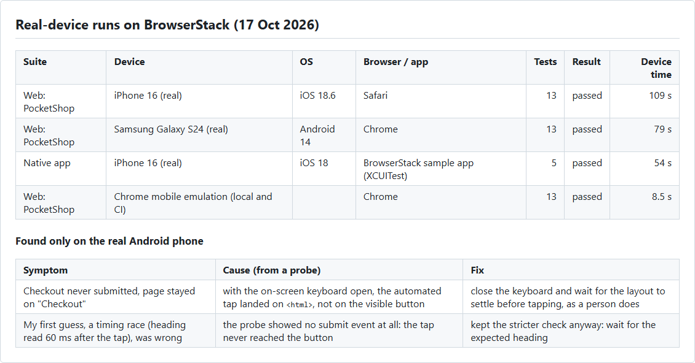

# Mobile testing on real devices with BrowserStack

[](https://github.com/niranjankagri/mobile-real-device-testing/actions/workflows/ci.yml)

Tests that run on **real phones** in BrowserStack's device cloud, in two parts:

1. **Mobile web:** PocketShop, a small responsive shop in this repository, tested with **Selenium 4** in **Safari on a
   real iPhone** and **Chrome on a real Android phone**. Real devices reach the shop on this machine through the
   **BrowserStack Local** tunnel. The same suite runs for free in Chrome's mobile emulation, locally and on every push.
2. **Native iOS app:** BrowserStack's sample app on a **real iPhone** with **Appium (XCUITest)**.

Java 21, TestNG. Written for a **100-minute free trial**: every real-device minute was planned and counted.



**Why the app is in this repository:** the web tests run against their own copy of PocketShop, started fresh for every
run. No shared environment means no bot checks, no outages and no changes somewhere else that break these tests. Real
devices reach it through the tunnel, the same way teams test a staging server that is not on the internet.

## What is tested

| Area | Tests | What it checks |
|---|---|---|
| Layout (`MobileLayoutTest`) | 5 | the browser really is phone-sized with touch; viewport meta tag; one product column; no page scrolls sideways; the menu sits behind a button, opens on tap and navigates |
| Touch and input (`TouchAndInputTest`) | 4 | buttons at least 44 × 44 CSS px; the right keyboard per field (`type`, `inputmode`, `autocomplete`); inputs at least 16 px (iOS Safari zooms into smaller ones); the main button stays in thumb reach |
| Shopping flow (`ShoppingFlowTest`) | 4 | quantity and cart badge; the cart survives a reload; validation errors move focus to the first invalid field; a complete purchase |
| Native app (`SampleAppTest`) | 5 | starts on the right tab; text typed on the real keyboard is shown back; a native alert opens and closes; the web view tab loads web content; tab switching |

## What the real devices found

The Android phone failed the checkout test that passed in local Chrome and on the iPhone. A screenshot showed a valid
form and no errors, yet the order was never placed. My first guess, a timing race, was wrong. A probe in a single
40-second run showed the real cause: **with the on-screen keyboard open, the automated tap landed on `<html>`, not on
the visible button**, so no submit event fired. The tests now close the keyboard and wait for the layout to settle
before tapping, as a person does (`PocketShop.tapAfterTyping`).

Emulation does not have an on-screen keyboard. This is the kind of difference that only a real device shows.

## Spending the 100 minutes carefully

| Decision | Effect |
|---|---|
| Develop against Chrome mobile emulation | the 13 web tests run in 8.5 s locally and in CI for free |
| One device session per suite, state reset between tests | session start-up paid once per run |
| Native locators from **one** 26-second discovery session (element trees of every tab saved to files) | no trial and error on the device |
| Single-test runs while fixing (`-Dtest=ShoppingFlowTest`) | the Android diagnosis cost about 50 s per try |
| Idle timeout 2 minutes instead of 5 | a hung run cannot eat the minutes |
| Real devices in CI only when started by hand | a push can never spend minutes |

Used for everything in this repository, including the failed tries: **about 9.5 Automate minutes and 1.3 App Automate
minutes.**

## Why not the Sauce Labs demo app on iOS?

My Android framework tests the Sauce Labs demo app, and an iOS version exists. BrowserStack rejected every iOS build of it:
a real iPhone only runs apps signed for it, BrowserStack re-signs uploads with its own certificates, and that needs a
development or ad-hoc provisioning profile inside the IPA. Uploads of versions 2.1.2, 2.2.2 and 2.3.0 were all
rejected, and the 2.3.0 IPA has no provisioning profile in it. BrowserStack's sample app is signed for its devices.

## Running it (Windows cmd)

Needs Java 21 and Chrome. For real devices: a BrowserStack account, with the credentials in the environment (never in
files):

```
setx BROWSERSTACK_USERNAME "your_username"
setx BROWSERSTACK_ACCESS_KEY "your_access_key"
```

Then, in a new terminal:

```
cd /d D:\Data\Work\mobile-real-device-testing
mvnw.cmd test                                web suite, Chrome mobile emulation (free)
mvnw.cmd test -Dtarget=iphone                web suite, Safari on a real iPhone 16
mvnw.cmd test -Dtarget=android               web suite, Chrome on a real Samsung Galaxy S24
mvnw.cmd test -Dsuite=app                    native app suite, real iPhone 16
mvnw.cmd test -Dtarget=android -Dtest=ShoppingFlowTest     one class only (saves minutes)
```

The native suite needs BrowserStack's sample app uploaded once under the custom id `bstack-sample-ios`:

```
curl -u "%BROWSERSTACK_USERNAME%:%BROWSERSTACK_ACCESS_KEY%" -X POST "https://api-cloud.browserstack.com/app-automate/upload" -F "url=https://www.browserstack.com/app-automate/sample-apps/ios/BStackSampleApp.ipa" -F "custom_id=bstack-sample-ios"
```

Failures leave a screenshot (and for the app, the element tree) in `reports\`. Sessions, videos and logs are in the
BrowserStack dashboard under the project "mobile-real-device-testing".

## Project structure

```
src/main/resources/site/   PocketShop: five pages, styles.css (mobile first), app.js (cart in localStorage), images
src/main/java/com/niranjankagri/mobile/
  site/SiteServer          serves the site with the JDK's HTTP server
  config/Target            local | iphone | android, and the host each one uses
  config/BrowserStack      hub, credentials from the environment, session options
  driver/WebDrivers        Chrome mobile emulation or a real phone browser; reports the result to BrowserStack
  driver/Tunnel            BrowserStack Local
  driver/AppDrivers        IOSDriver for the native app on a real iPhone
src/test/java/com/niranjankagri/mobile/
  web/                     WebTestBase, PocketShop (page actions), three test classes
  app/                     AppTestBase, SampleAppTest
```

## CI

[`.github/workflows/ci.yml`](.github/workflows/ci.yml): on every push, the web suite in headless Chrome mobile
emulation. Real devices only through "Run workflow" with a choice (iPhone web, Android web, iPhone app, or all); they
need the repository secrets `BROWSERSTACK_USERNAME` and `BROWSERSTACK_ACCESS_KEY`.

See [docs/framework-design.md](docs/framework-design.md) and [docs/interview-questions.md](docs/interview-questions.md).

## License

MIT
